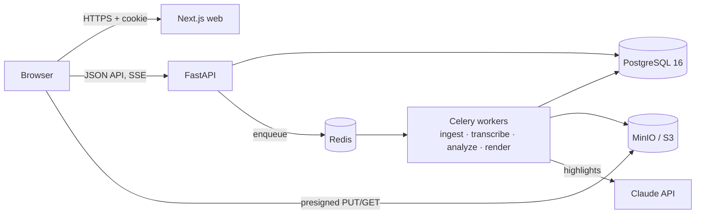

# ClipForge

Self-hostable AI tool that turns long-form video into short, captioned, vertical clips.
Upload a video or paste a URL, and ClipForge transcribes it, finds the most clip-worthy
moments with Claude, reframes them to 9:16 around the active speaker, and burns in
animated captions.

> **Status:** Phase 3 (transcription). Highlight detection and rendering land in later phases.

## Quick start

Requirements: Docker with Compose v2, GNU Make. For local development without Docker,
you also need Node 22 with pnpm 10, [uv](https://docs.astral.sh/uv/), and Python 3.12.

```bash
make env            # creates .env from .env.example with a random JWT_SECRET
$EDITOR .env        # set ANTHROPIC_API_KEY
make up             # builds and starts everything, waits until all services are healthy
make health         # {"status": "ok", ...}
open http://localhost:3000
```

| Service                       | URL                                                 |
| ----------------------------- | --------------------------------------------------- |
| Web                           | http://localhost:3000                               |
| API (OpenAPI docs at `/docs`) | http://localhost:8000                               |
| MinIO console                 | http://localhost:9001 (`minioadmin` / `minioadmin`) |

## Architecture



Startup order in Compose: `postgres` → `migrate` (Alembic `upgrade head`) and
`minio` → `storage-init` (creates the bucket idempotently) → `api`, `worker` → `web`.

## Repository layout

```
apps/api              FastAPI + Celery (Python 3.12, uv)
  app/api/routes      HTTP routes
  app/core            settings, logging, security
  app/db              SQLAlchemy models and session
  app/schemas         Pydantic request/response models
  app/services        storage, health, and pipeline services
  app/workers         Celery app and tasks
  alembic             migrations
apps/web              Next.js 15 App Router (TypeScript strict, Tailwind, shadcn/ui)
packages/shared-types TS types generated from the API's OpenAPI schema
```

## Development

```bash
make install        # uv sync + pnpm install
make check          # ruff, mypy --strict, pytest, eslint, prettier, tsc, vitest, types-check
make fmt            # auto-format everything
make types          # regenerate packages/shared-types after changing API schemas
make migration m="add foo"   # autogenerate an Alembic migration
```

API response types are generated from OpenAPI into `packages/shared-types`. Never write them
by hand. CI fails if they are stale.

## Configuration

All settings come from environment variables (see `.env.example`). The API and workers
refuse to start if a required variable is missing, if `JWT_SECRET` is shorter than 32
characters, or if a value is still a `<placeholder>`. The web app validates
`NEXT_PUBLIC_API_URL` with Zod at build time and at startup.

| Variable                                        | Purpose                                                 |
| ----------------------------------------------- | ------------------------------------------------------- |
| `DATABASE_URL`                                  | Postgres URL, must use `postgresql+asyncpg://`          |
| `REDIS_URL`                                     | Celery broker/result backend                            |
| `S3_ENDPOINT` / `S3_PUBLIC_ENDPOINT`            | Internal and browser-reachable object storage endpoints |
| `S3_ACCESS_KEY` / `S3_SECRET_KEY` / `S3_BUCKET` | Object storage credentials and bucket                   |
| `ANTHROPIC_API_KEY` / `LLM_MODEL`               | Claude access for highlight detection                   |
| `WHISPER_MODEL` / `WHISPER_DEVICE`              | Transcription model and `cuda`/`cpu`/`auto`             |
| `MAX_UPLOAD_GB` / `MAX_DURATION_MIN`            | Ingest limits                                           |
| `JWT_SECRET`                                    | Session signing key (`openssl rand -hex 32`)            |
| `CORS_ORIGINS`                                  | Comma-separated origins allowed to call the API         |
| `NEXT_PUBLIC_API_URL`                           | API base URL as seen from the browser                   |

## Testing

`make check` runs everything. Database tests need PostgreSQL. Start it with
`docker compose up -d postgres`. Tests only ever use a database whose name ends in `_test`
(created automatically). Without a database they are skipped locally, and in CI they fail.
Media tests generate synthetic clips with ffmpeg, so ffmpeg must be on your `PATH`.

## Security notes

- **Ownership:** every project route filters by the session user. Another user's resources
  return `404`, never `403`.
- **Uploads:** presigned keys are server-generated under `uploads/{user_id}/`. Project creation
  rejects keys outside the caller's prefix and HEAD-checks the object's size.
- **SSRF:** pasted URLs must be http(s) on port 80/443, without credentials, and every resolved
  address must be public. The media URLs yt-dlp selects are checked again before download.
  DNS rebinding between check and fetch isn't fully preventable at this layer, so run workers
  without access to internal services if that matters in your deployment.

## Transcription and GPUs

Transcription runs in its own worker (`worker-transcribe`, one task at a time) because it holds
a Whisper model in memory. Models download from Hugging Face on first use into the
`whispermodels` volume, so the first transcription is slower.

- **CPU (default in Compose):** with `WHISPER_DEVICE=auto` and no GPU, the worker uses
  `WHISPER_CPU_MODEL` (default `small`, int8). Expect it to be much slower than a GPU.
- **NVIDIA GPU:** install the NVIDIA Container Toolkit, give `worker-transcribe` a GPU
  (`deploy.resources.reservations.devices` with `capabilities: [gpu]`), and it switches to
  `WHISPER_MODEL` (default `large-v3`, float16). The image needs CUDA 12 and cuDNN 9 runtime
  libraries for this. Use an NVIDIA CUDA base image or install `nvidia-cublas-cu12` and
  `nvidia-cudnn-cu12`.
- **Long videos:** audio over 60 minutes is transcribed in 30-minute chunks that overlap by
  5 seconds, which bounds memory. Each overlap is resolved at its midpoint, so no words are
  duplicated or lost at the seams.
- **Offline hosts:** pre-download a model and point `WHISPER_MODEL_DIR` at it.

## Notes

- **MinIO image:** MinIO stopped publishing images to Docker Hub, so Compose uses
  `pgsty/minio`, a community build of the same server. Any S3-compatible store works.
  Point the `S3_*` variables at it and drop the `minio` service.
- **Health:** `GET /healthz` checks Postgres, Redis and object storage in parallel with a
  2s timeout each. It returns `200` when all pass and `503` with per-dependency detail otherwise.
